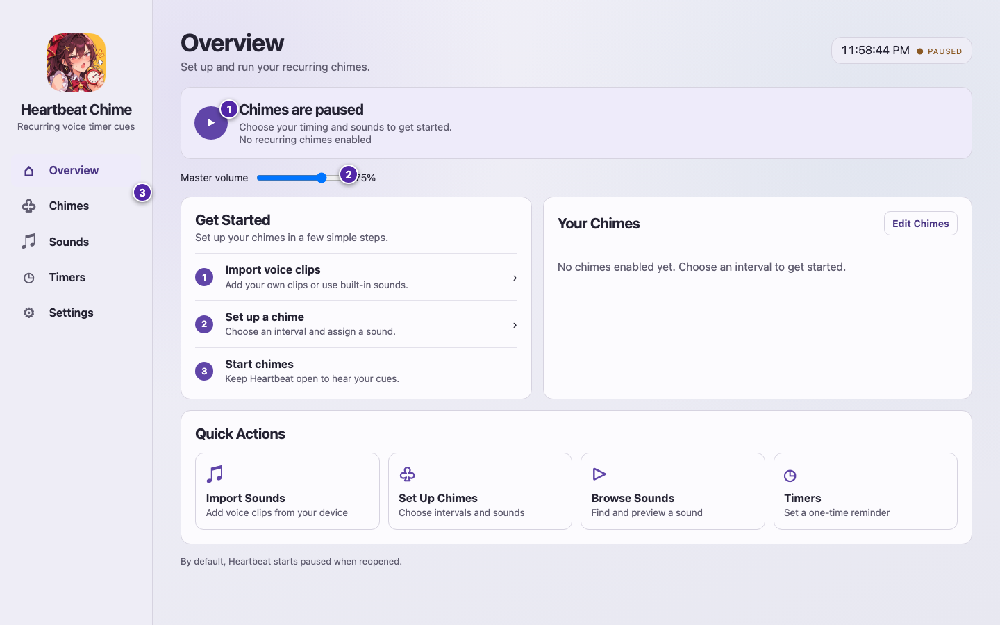
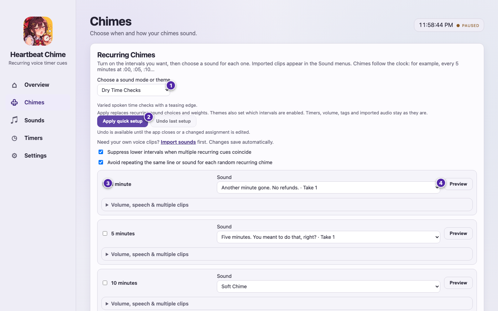
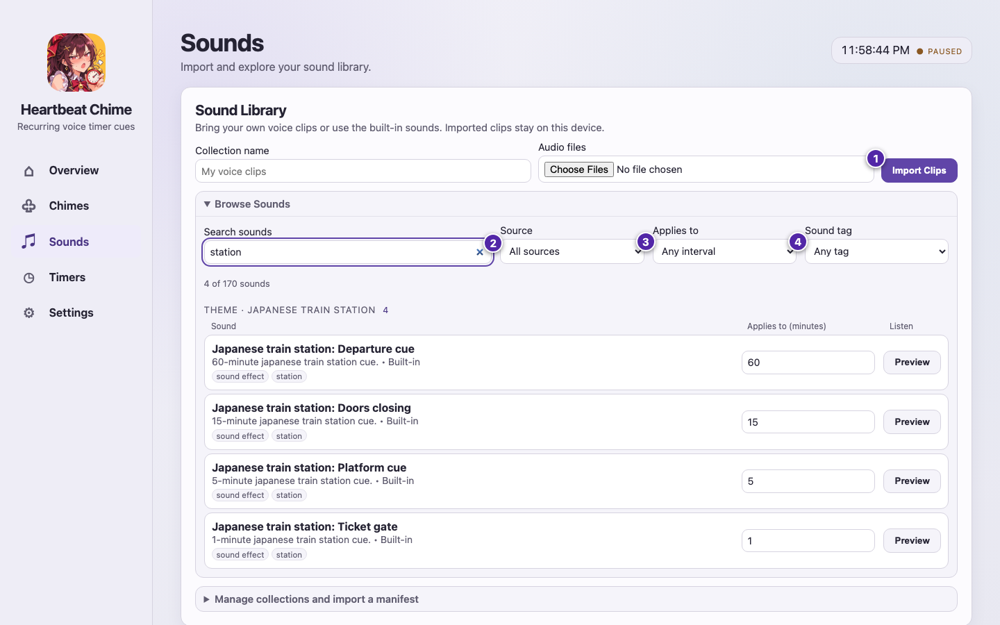
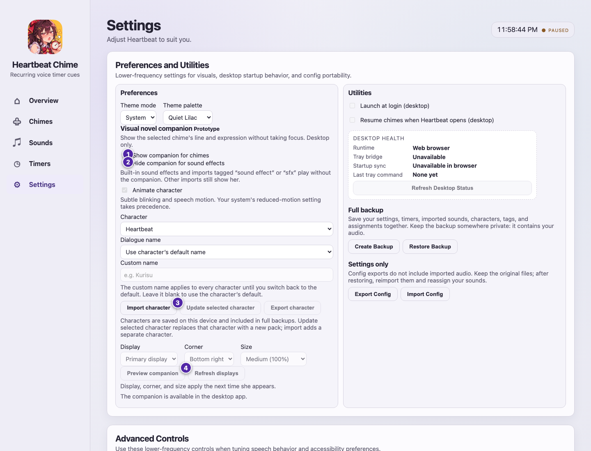

# Heartbeat user guide

Heartbeat plays clock-aligned chimes and one-shot timers. Choose built-in voices and sound effects, import your own audio, and optionally add a desktop companion. This guide describes the current source preview; platform-specific behavior still needs validation on the target machine. See [Run from source](../README.md#run-from-source) to get started.

The screenshots show a fresh, disposable **browser preview**, so desktop-only controls are disabled. Your own settings and selected sounds may look different.

## Start and stop chimes

1. Open **Chimes** (3), enable at least one interval and choose its sound. Return to **Overview** and press the round play button (1). Use the same button to pause.
2. Adjust **Master volume** (2); individual intervals also have their own volume under **Volume, speech & multiple clips**. Preview a sound before leaving it running.
3. Keep Heartbeat running. A five-minute chime follows the clock at :00, :05, :10, and so on; it is not a five-minute countdown from when you press Start. The app starts paused on reopening unless you opt into resuming in Settings.

## Choose intervals or apply a theme

Choose a mode or themed sound set (1). **Apply quick setup** (2) replaces the recurring sound choices and weights; themes also change which intervals are enabled. The description explains the impact. **Undo last setup** restores the previous recurring setup for the current session, unless you have edited one of the affected assignments or enabled states afterward. For a portable snapshot, create a full backup first.

To mix sounds, change individual intervals instead: enable the checkbox (3), select its **Sound** (4), and use **Preview**. For a random or weighted pool, open **Volume, speech & multiple clips**, select more than one clip, and choose the playback mode. The interval tag filter narrows the list without losing selected clips. You can adjust weights for weighted random and avoid consecutive repeats using the setting above the interval list.

## Import and find sounds

Enter a collection name, choose audio files and select **Import Clips** (1). The files are stored on this device. You can then assign individual clips in Chimes; importing alone does not enable an interval. File support depends on the platform's audio decoder.

Open **Browse Sounds** to search (2), filter by source (3), suggested interval (4), or sound tag, and preview clips. A sound's **Applies to (minutes)** field accepts comma-separated values, such as `1, 5`. These are suggestions for filtering, not automatic assignments. Selecting or changing a filter does not change what is scheduled. Manage imported collections and advanced manifest packs in the disclosure at the bottom.

For making spoken clips with a provider or system speech, see [creating voice and sound clips](character-creator/audio-generation.md).

## Use a companion

In the **desktop app**, go to **Settings → Visual novel companion**. Enable **Show companion for chimes** (1), then choose a display, corner and size. Use **Preview companion** (4). The browser screenshot shows these desktop-only controls disabled.

To keep sound effects from showing the character, enable **Hide companion for sound effects** (2). This recognizes built-in effects and imported pack sounds tagged `sound effect` or `sfx`; unclassified imported clips retain the companion. Voiceovers still show it.

Use **Import character** (3) to add a character JSON, then select it. **Update selected character** replaces an imported character in place; **Import character** adds another. Choose the default dialogue name or set a custom name. Character packs change the artwork; they do not replace voices or create custom expression mappings for imported audio. See the [agent-assisted character creator](character-creator/README.md).

## Timers, startup and backups

- **Timers:** create a relative timer or choose a target time on the Timers page. Enable chimes to allow it to fire.
- **Start at login:** in desktop Settings, **Launch at login** opens the app at login. **Resume chimes when Heartbeat opens** is a separate opt-in. Startup and sleep/wake behavior should be checked on your own system.
- **Full backup:** Settings → **Create Backup** includes settings, timers, imported audio, character packs, tags and assignments. Treat the file as private. **Restore Backup** replaces settings and timers and adds imported sounds and characters; the local launch-at-login setting is preserved. A partial failure can leave extra imported copies, so review the status before retrying.
- **Settings only:** config export does not include imported audio or character packs. Keep the original files and use a full backup if you need a portable copy of your library.

## Troubleshooting

- **Nothing plays:** confirm an interval is enabled, the engine is started, system and Heartbeat volumes are audible, and the chosen clip previews. Browser playback may require a user gesture. Check the OS audio output.
- **The companion does not show:** use the desktop app, enable it in Settings and check the selected display. If you enabled the sound-effect suppression option, try a bundled voice cue.
- **A sound is missing after moving computers:** settings-only export does not include imported audio. Restore a full backup or reimport your original files and reassign them.
